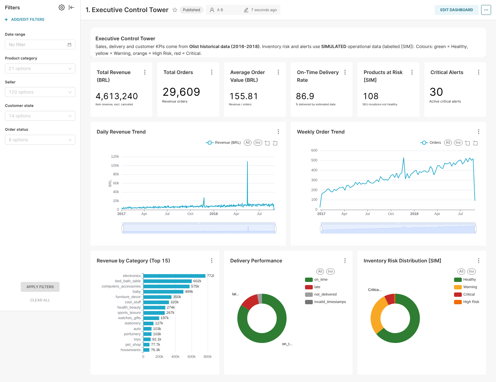
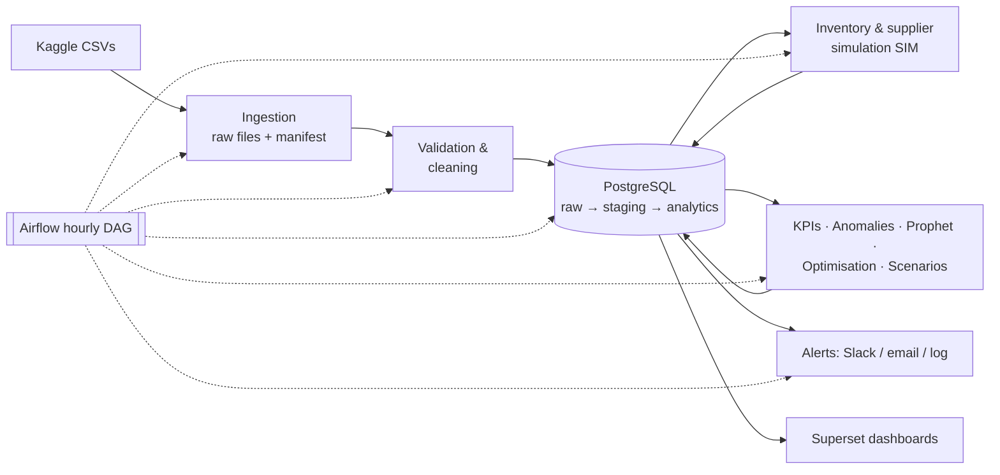
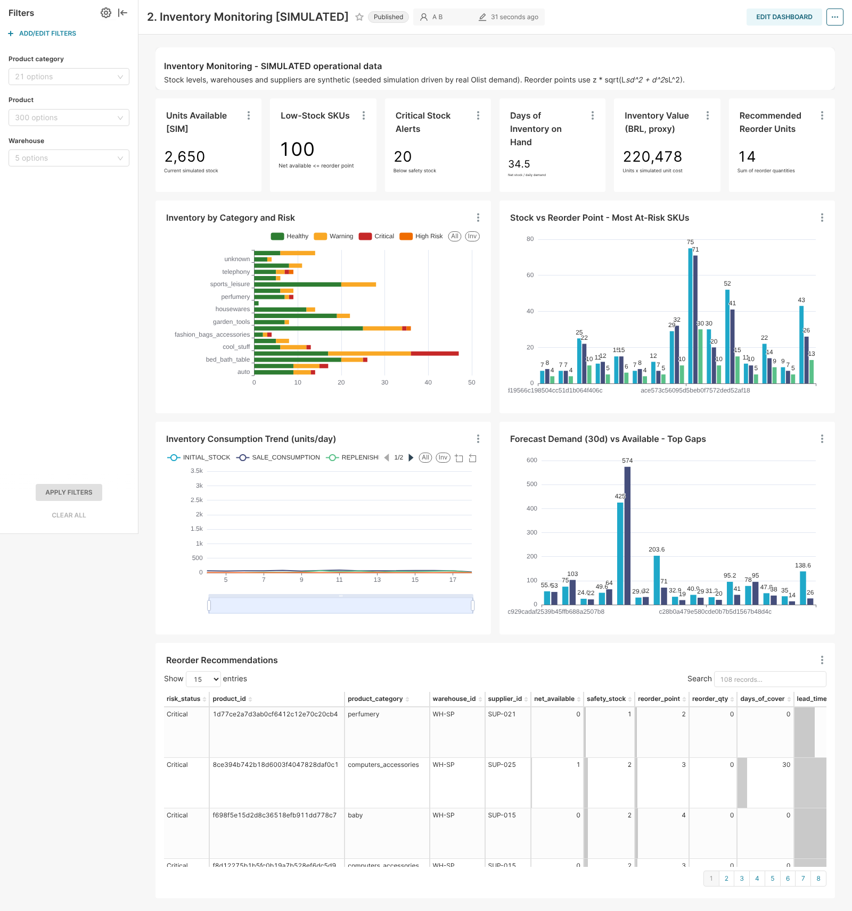
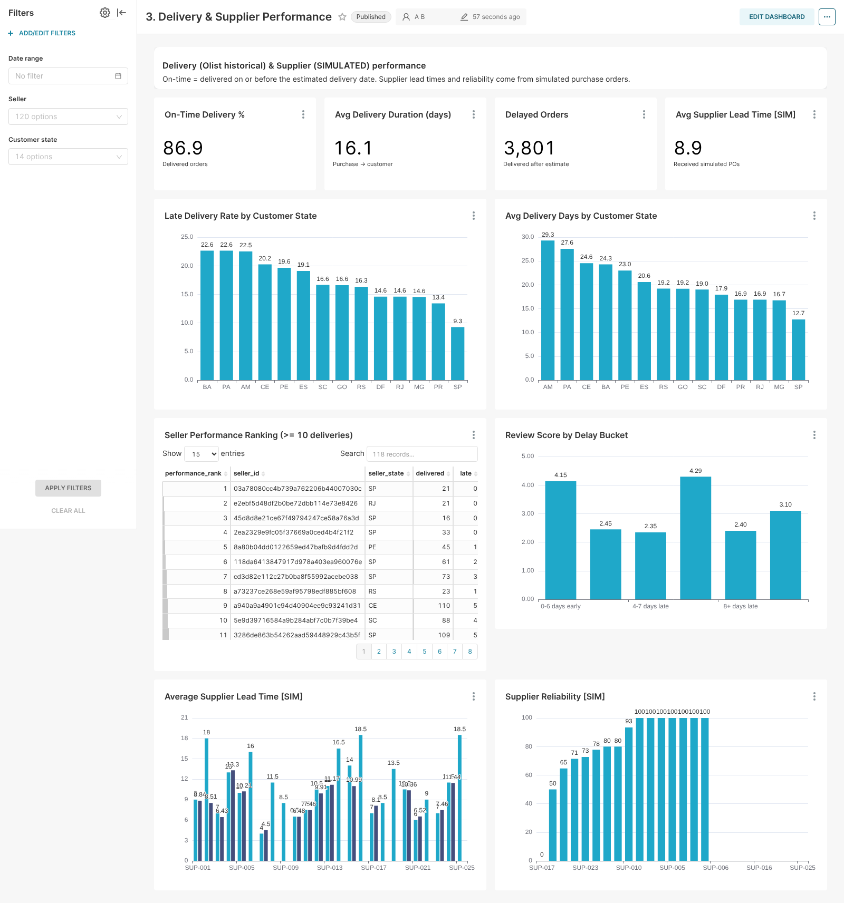
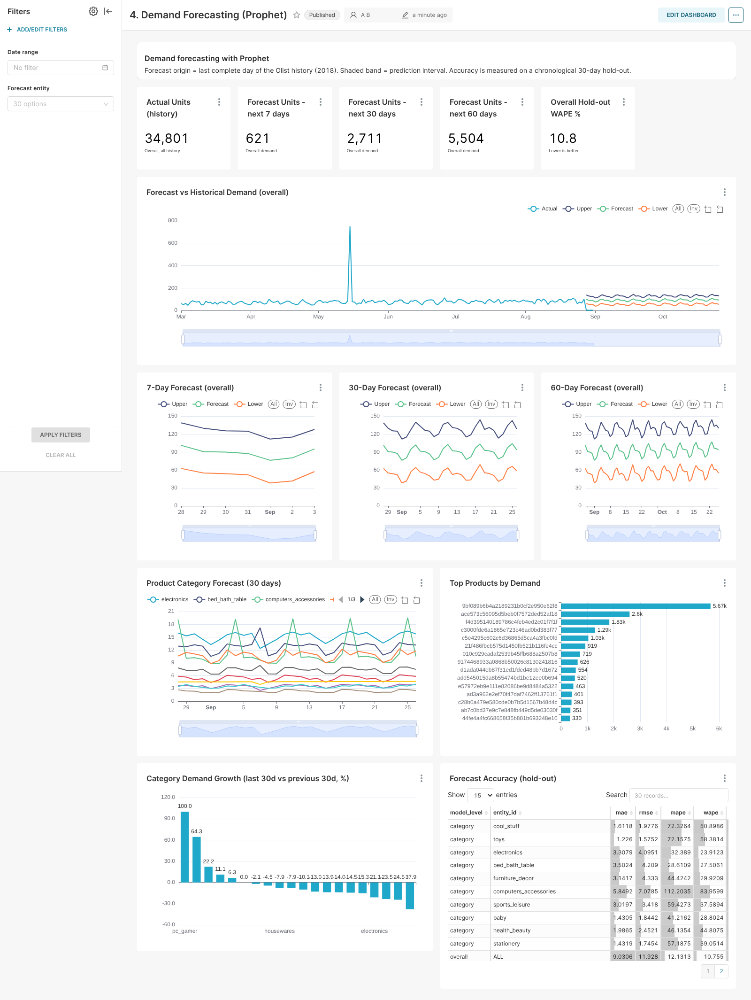
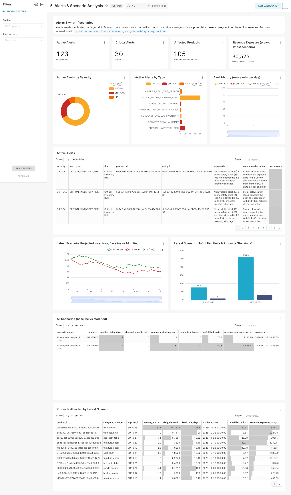

# Retail and Supply Chain Control Tower

An end-to-end supply chain monitoring platform built on the **Olist Brazilian E-Commerce** dataset. It covers
ingestion, data quality, a PostgreSQL star schema, Airflow orchestration, inventory and supplier simulation,
KPIs, anomaly detection, Prophet forecasting, replenishment optimisation, what-if scenarios, Slack/email alerts and
five Apache Superset dashboards.


*Screenshot produced from the synthetic sample dataset (not real Olist figures).*

---

## 1. Business problem and objectives
Retail teams usually notice stock-outs, late deliveries and unreliable suppliers only after sales and customer
satisfaction have already suffered. The control tower gives one near-real-time view of **sales, inventory,
deliveries, suppliers and demand** so that problems are flagged before they hit customers. It answers:

| Question | Where |
|---|---|
| Which products have increasing demand? / Which categories have the highest demand? | `vw_product_demand_growth`, `vw_category_demand`, Dashboard 4 |
| Which products risk running out of stock? Which need immediate attention? | `inventory_thresholds` risk classes, Dashboards 2 and 5 |
| Which sellers have delivery delays? How do delays affect satisfaction? | `vw_seller_performance`, `vw_review_by_delay_bucket`, Dashboard 3 |
| Which suppliers have poor (simulated) lead-time performance? | `vw_supplier_kpis`, Dashboard 3 |
| How much inventory should be replenished? | `reorder_qty` per SKU, Dashboard 2 |
| What happens if a supplier is delayed by 7 days? | `src/optimization/scenario_analysis.py`, Dashboard 5 |
| What will demand look like over the next 30 days? | Prophet forecasts, Dashboard 4 |

## 2. Dataset, attribution and historical vs simulated data
**Source:** [Brazilian E-Commerce Public Dataset by Olist](https://www.kaggle.com/datasets/olistbr/brazilian-ecommerce),
licensed **CC BY-NC-SA 4.0** (see [LICENSE_DATASET.md](LICENSE_DATASET.md)). The pipeline uses 9 CSVs: orders,
order items, customers, products, sellers, payments, reviews, geolocation, and the category translation
(~100k orders, 2016-2018).

| Data | Origin | Label |
|---|---|---|
| Orders, items, payments, reviews, customers, sellers, products, geolocation | **Olist - real historical** | – |
| Inventory, warehouses, suppliers, purchase orders, lead times, inbound shipments | **Simulated** (demand derived from real Olist demand, seeded) | `is_simulated = TRUE`, "[SIM]" |
| `data/sample/*.csv` | **Synthetic** Olist-schema sample for tests/offline demo | `DATA_SOURCE=sample` |

Olist provides no inventory or supplier data and no live feed. The hourly pipeline refreshes the **simulated
operational feed** and recomputes analytics. It does **not** pretend Kaggle delivers new transactions.

## 3. Technology stack
Python 3.11 · pandas · NumPy · SciPy · PostgreSQL 16 · SQLAlchemy/psycopg2 · Apache Airflow 2.10.5 ·
scikit-learn (Isolation Forest) · Prophet 1.1.6 · Plotly · Apache Superset 4.1.2 · Slack webhooks / SMTP ·
Docker Compose · pytest. All versions are pinned in `requirements.txt`.

## 4. Architecture

Details, ER diagram and design decisions: [docs/architecture.md](docs/architecture.md).

## 5. Database schema
* Database `retail_supply_chain`, schemas `raw` → `staging` → `analytics`.
* **Dimensions:** `dim_date`, `dim_product`, `dim_customer`, `dim_seller`, `dim_supplier` [SIM], `dim_warehouse` [SIM].
* **Facts:** `fact_orders`, `fact_order_items`, `fact_payments`, `fact_reviews`, `fact_shipments`, `fact_inventory` [SIM],
  `fact_inventory_movements` [SIM], `fact_supplier_performance` [SIM], `fact_demand_forecast`.
* **Supporting tables:** `inventory_thresholds`, `alert_history`, `simulation_scenarios` (+ `scenario_results`,
  `scenario_projection`), `anomaly_events`, `forecast_accuracy`, `etl_run_log`, `data_quality_log`.

All of these are created by `sql/02-07` and populated by `sql/09`. The full column list is in
[docs/data_dictionary.md](docs/data_dictionary.md).

Modelling rules:
* An order has many items and payments, which are aggregated *before* the join (no double counting).
* `customer_unique_id` (the person) is kept separate from `customer_id`, which is unique per order.
* Seller delivery metrics use the order × seller grain.

## 6. ETL pipeline (`dags/retail_supply_chain_etl.py`, hourly)
`check_source_files → load_csv_files → validate_source_data → clean_and_preprocess → load_raw_tables →
populate_staging → run_sql_transformations → generate_inventory_simulation → update_inventory_kpis →
run_anomaly_detection → update_demand_forecasts → evaluate_alert_thresholds → send_notifications →
log_execution_results` (the last task runs even if an earlier one fails).

* **Retries and failure handling:** 2 retries with exponential backoff and a failure callback that sends an alert.
* **Run behaviour:** `max_active_runs=1`. Every task is logged in `analytics.etl_run_log`.
* **Incremental:** loads are skipped when the SHA-256 checksums of the source files are unchanged. Forecasts are
  refreshed every 24 h or when the data changes.
* **Idempotent:** TRUNCATE+COPY in transactions, upserts and deterministic IDs.
* **Data-quality gate:** CRITICAL check failures stop the run.

## 7. KPIs
Sales and demand, delivery, customer, inventory [SIM] and supplier [SIM]. Formulas, SQL objects and limitations
are in [docs/kpi_definitions.md](docs/kpi_definitions.md).

## 8. Machine learning and optimisation
| Component | Method | File |
|---|---|---|
| Anomaly detection | Rolling Z-score (past-only window), robust Z (MAD), Isolation Forest; 7 anomaly types with severity and recommended action | `src/ml/anomaly_detection.py` |
| Demand forecasting | Prophet for overall, top categories and top products; 60-day horizon (7/30/60) with prediction intervals; chronological 30-day hold-out (MAE, RMSE, MAPE, WAPE vs seasonal-naive); weekly seasonality only if statistically supported; no yearly seasonality (<2 years of data) | `src/ml/demand_forecasting.py` |
| Replenishment | Safety stock `z·√(Lσd²+d²σL²)`, ROP `d·L+SS`, order-up-to quantity; risk classes Critical / High Risk / Warning / Healthy | `src/optimization/inventory_optimization.py` |
| What-if | Daily projection baseline vs modified (supplier delay, demand growth, inventory, replenishment quantity, safety stock) | `src/optimization/scenario_analysis.py` |

Full methodology and its limitations: [docs/methodology.md](docs/methodology.md).

## 9. Dashboards (Apache Superset)
Five dashboards are created as code by `superset/bootstrap_dashboards.py`:
1. Executive Control Tower
2. Inventory Monitoring [SIM]
3. Delivery & Supplier Performance
4. Demand Forecasting
5. Alerts & Scenario Analysis

They include native filters for date, category, product, seller, customer state, order status and alert
severity, and use the colours Healthy = green, Warning = yellow, High Risk = orange, Critical = red. Setup steps
are in [superset/dashboard_setup.md](superset/dashboard_setup.md).

| | |
|---|---|
|  |  |
|  |  |

*Screenshots are from the synthetic sample. Replace them with screenshots from your run on the real Kaggle data.*

---

## 10. Installation

### Option A - Docker Compose (recommended)
```bash
git clone <your-repo-url> retail-supply-chain-control-tower && cd retail-supply-chain-control-tower
cp .env.example .env              # edit all passwords/secret keys; on Linux set AIRFLOW_UID=$(id -u)

# Get the data (choose one)
#  a) Kaggle API: put KAGGLE_USERNAME/KAGGLE_KEY in .env, then after the stack is up:
#     docker compose exec airflow-webserver python -m src.ingestion.kaggle_download --method api
#  b) Manual: download archive.zip from the Kaggle page and run
#     python -m src.ingestion.kaggle_download --method manual --zip ~/Downloads/archive.zip
#     (or unzip the 9 CSVs into data/raw/)
#  c) Offline demo without Kaggle: set DATA_SOURCE=sample in .env and run
#     docker compose exec airflow-webserver python -m src.ingestion.sample_data

docker compose up -d --build      # postgres, airflow-init, airflow-webserver, airflow-scheduler, superset
docker compose ps                 # wait until services are healthy
```
| UI | URL | Login |
|---|---|---|
| Airflow | http://localhost:8080 | `AIRFLOW_ADMIN_USER` / `AIRFLOW_ADMIN_PASSWORD` |
| Superset | http://localhost:8088 | `SUPERSET_ADMIN_USER` / `SUPERSET_ADMIN_PASSWORD` |
| PostgreSQL | localhost:5432 | `POSTGRES_USER` / `POSTGRES_PASSWORD` |

### Option B - local Python (no Docker)
```bash
python3.11 -m venv .venv && source .venv/bin/activate
pip install -r requirements-dev.txt
cp .env.example .env              # POSTGRES_HOST=localhost and your local credentials
psql -h localhost -U postgres -f sql/01_create_database.sql   # optional; the pipeline also creates it
python -m src.pipeline.run_pipeline            # full pipeline once
```

## 11. Running the pipeline
**Airflow:** open the UI, un-pause `retail_supply_chain_etl` (it is paused when created) and trigger a run. It then
runs hourly. From the CLI:
```bash
docker compose exec airflow-webserver airflow dags unpause retail_supply_chain_etl
docker compose exec airflow-webserver airflow dags trigger retail_supply_chain_etl
```
The first run bootstraps 14 days of hourly simulated history. The Olist load takes a few minutes; later runs only
refresh the simulation and analytics.

**Without Airflow:** `python -m src.pipeline.run_pipeline [--until 2026-01-01T10:00]`, or
`./scripts/run_local_demo.sh` for the synthetic sample.

**What-if scenario (7-day supplier delay):**
```bash
python -m src.optimization.scenario_analysis --delay 7                       # all suppliers
python -m src.optimization.scenario_analysis --supplier SUP-003 --delay 7 --growth 15 --inventory-adj -10
```
Results are stored in `simulation_scenarios` / `scenario_results` / `scenario_projection`, and an interactive
Plotly comparison is written to `reports/scenarios/<id>.html`.

## 12. Superset setup
After the first successful pipeline run (and one scenario), run `./scripts/bootstrap_superset.sh`. It creates the
DB connection, 31 datasets, 5 dashboards and 57 charts. Details: [superset/dashboard_setup.md](superset/dashboard_setup.md).

## 13. Slack and email alerts
Set `ALERT_MODE` in `.env`:
* `local` (default) writes to `reports/alerts/alerts_outbox.jsonl` and the logs.
* `slack` needs `SLACK_WEBHOOK_URL` (Slack app → Incoming Webhooks).
* `email` needs `SMTP_HOST`, `SMTP_PORT`, `SMTP_USER`, `SMTP_PASSWORD`, `ALERT_EMAIL_FROM`, `ALERT_EMAIL_TO`.
* `all` sends to every configured channel.

Credentials are read only from environment variables. Example message:
```
SUPPLY CHAIN ALERT
Alert ID: ALT-bf20bf7e0050e0      Severity: CRITICAL      Alert Type: Critical Inventory Risk
Product: 0aef2b1054583616d426386c18452387
Available Stock: 1 units (net 1)   Forecast Demand (lead time): 2 units   Supplier Lead Time: 18.5 days
Explanation: Net available stock (1) is below safety stock (3) ... Risk: projected inventory shortage.
Recommended Action: Initiate replenishment immediately: expedite 1 units from SUP-016 ...
Note: based on SIMULATED operational data (inventory/supplier).
```
Alerts are de-duplicated by fingerprint, re-sent only after a 24 h cooldown or when severity escalates,
auto-resolved when the condition clears, and stored in `analytics.alert_history`.

## 14. Testing
```bash
pytest                       # 77 tests: unit + integration (integration needs PostgreSQL; skipped otherwise)
pytest -m "not integration"  # unit tests only, no database needed
docker compose exec airflow-webserver pytest   # inside the stack
```
* **Data:** the tests generate their own synthetic sample, so no Kaggle download is needed.
* **Database:** integration tests use a separate `<POSTGRES_DB>_test` database.
* **Coverage:**
  * ingestion and clear failure on missing files
  * DB connectivity, duplicate prevention, data types and FK integrity
  * no fan-out double counting
  * KPI formulas and SQL-vs-Python parity
  * forecast generation, accuracy and no leakage
  * reorder point, safety stock and quantity
  * simulation idempotency
  * the 7-day delay scenario
  * planted anomalies are detected
  * alert generation, dedup, Slack failure handling and the digest

## 15. Project structure
```
config/        settings.py (env-driven), database.py (engine, COPY, upsert)
dags/          retail_supply_chain_etl.py
sql/           01-09 DDL, views, indexes, KPI queries, transformation
src/ingestion  kaggle_download.py, load_data.py, sample_data.py
src/preprocessing  data_validation.py, clean_data.py
src/transformations  build_analytics_model.py, kpi_calculations.py
src/simulation  inventory_simulator.py, supplier_simulator.py
src/ml          anomaly_detection.py, demand_forecasting.py
src/optimization inventory_optimization.py, scenario_analysis.py
src/alerts      notification_service.py
src/pipeline    tasks.py (shared by Airflow + CLI), run_pipeline.py
superset/       bootstrap_dashboards.py, dashboard_setup.md, datasets.md
docker/         postgres-init, superset image + config
docs/           architecture, data dictionary, KPI definitions, methodology, screenshots
notebooks/      01 EDA, 02 data quality, 03 delivery, 04 forecasting
scripts/        bootstrap_superset.sh, run_local_demo.sh, generate_data_dictionary.py, build_notebooks.py
tests/          pytest suite (+ conftest with synthetic data and test DB)
```

## 16. Demonstration script (≈10 minutes)
1. **Architecture and the historical-vs-simulated distinction:** this README, sections 2 and 4.
2. **Airflow:** show the DAG graph, trigger a run, and point out the skipped tasks on a re-run (incremental) and
   `analytics.etl_run_log`.
3. **Data quality:** open `reports/data_quality/data_quality_report.md` and `cleaning_log.md`.
4. **Superset dashboard 1:** apply the date and state filters.
5. **Dashboard 2:** open a Critical SKU and its reorder recommendation.
6. **Dashboard 3:** compare the worst sellers with review scores by delay.
7. **Dashboard 4:** explain the forecast intervals and hold-out accuracy against the naive benchmark.
8. **Scenario:** run `python -m src.optimization.scenario_analysis --delay 7`, refresh dashboard 5 and compare
   baseline vs modified stock-outs and the exposure proxy.
9. **Alerts:** show `reports/alerts/alerts_outbox.jsonl` (or Slack) and the dedup behaviour on the next run.

## 17. Limitations
* Olist is static (2016-2018) and its last weeks are incomplete. Forecasts start from the last complete day of
  data, not from today, and are limited to 60 days.
* Inventory, suppliers, warehouses and lead times are simulated. Inventory KPIs show how the system behaves, not
  real stock positions.
* Olist has no quantity column; each order-item row counts as one unit.
* Revenue exposure is a proxy (unfulfilled units × historical price), not confirmed lost revenue.
* Anomalies are statistical signals, and promotions or data artefacts can trigger them (see methodology §6).
* Product-level forecasts on intermittent demand have high percentage errors. Category-level forecasts and
  prediction intervals are more reliable.
* The Docker setup is aimed at local or demo use: LocalExecutor, Superset Talisman disabled, no TLS.

## 18. Future improvements
* Real ERP/WMS inventory feeds through CDC (Debezium/Kafka) instead of simulation.
* dbt for the SQL layer, with Great Expectations data contracts.
* Intermittent-demand models (Croston/TSB), hierarchical reconciliation, and LightGBM global models.
* Multi-echelon inventory optimisation and supplier MOQ/price breaks.
* Alert acknowledgement workflow (Slack interactive buttons) and PagerDuty integration.
* CI pipeline (GitHub Actions) running pytest against a PostgreSQL service container.

---
*Data: Olist, CC BY-NC-SA 4.0. Simulated operational data is synthetic and labelled throughout.*
