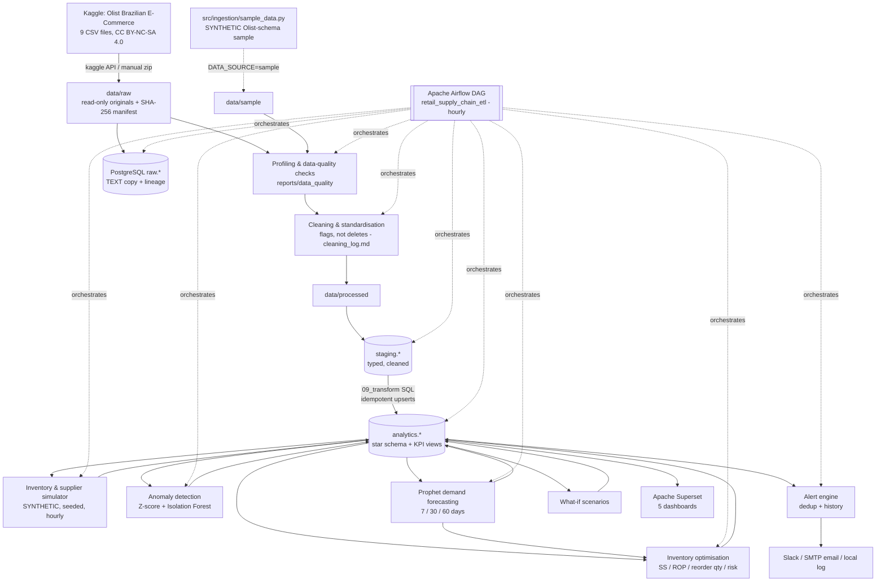
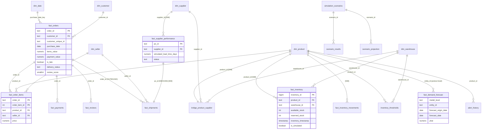

# Architecture

## End-to-end flow

## Runtime components (Docker Compose)

| Service | Image | Port | Purpose |
|---|---|---|---|
| `postgres` | postgres:16 | 5432 | Project DB `retail_supply_chain` + Airflow & Superset metadata DBs (created by `docker/postgres-init`) |
| `airflow-init` | built from `Dockerfile` (apache/airflow:2.10.5-python3.11) | – | `airflow db migrate` + admin user |
| `airflow-webserver` | same | 8080 | Airflow UI |
| `airflow-scheduler` | same | – | Runs the hourly DAG (LocalExecutor) |
| `superset` | built from `docker/superset/Dockerfile` (apache/superset:4.1.2 + psycopg2) | 8088 | Dashboards |

The project folder is mounted into the Airflow containers at `/opt/project`; the DAG imports the same
`src.pipeline.tasks` functions that the local CLI (`python -m src.pipeline.run_pipeline`) uses.

## Database layers

| Schema | Content | Load strategy |
|---|---|---|
| `raw` | Olist CSVs as TEXT + `_batch_id`, `_source_file`, `_loaded_at`; `raw.load_audit` | TRUNCATE + COPY per table in one transaction; skipped if checksum unchanged |
| `staging` | Typed, cleaned, standardised Olist data | TRUNCATE + COPY of all 9 tables in one transaction |
| `analytics` | Dimensions, facts, supporting tables, KPI views, ML outputs, simulated data | `INSERT ... ON CONFLICT DO UPDATE` (upserts) + deterministic IDs |

## ER diagram (analytics layer)

## Key design decisions

| Decision | Reason |
|---|---|
| Raw layer stores TEXT | Faithful, re-playable copy; no load fails because of a single bad value; type problems are measured by validation instead. |
| Flag, don't delete | Bad timestamps / zero prices are kept and flagged so revenue is not silently lost; KPIs exclude them only where they would distort the metric (documented). |
| Aggregate children before joining | `fact_orders` gets item / payment totals from pre-aggregated CTEs, so an order with 3 items and 2 payments is never counted 6 times. |
| Shipments at order x seller grain | An Olist order can be fulfilled by several sellers; seller delivery KPIs need that grain. |
| Separate simulation clock | Olist ends in 2018; operational simulation runs on the pipeline's UTC hour and is clearly labelled `is_simulated`. |
| Checksum-based incremental loads | The Olist files are static; hourly runs skip unchanged loads but still refresh simulated feeds, KPIs and alerts. |
| One task module for Airflow and CLI | The DAG is a thin wrapper; all logic is unit-/integration-tested without Airflow. |
| Superset built through the REST API | Dashboards are reproducible code (`superset/bootstrap_dashboards.py`), not manual clicks. |
